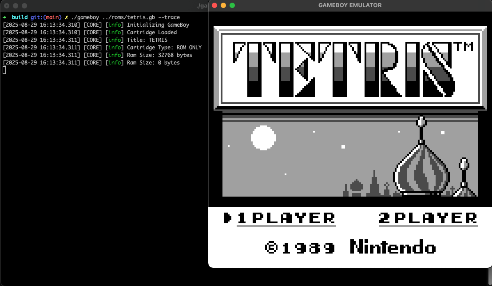
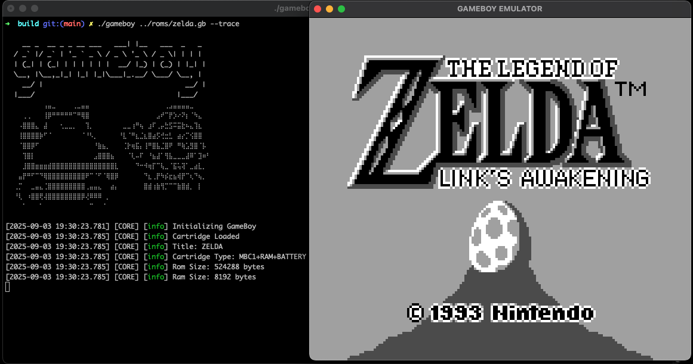
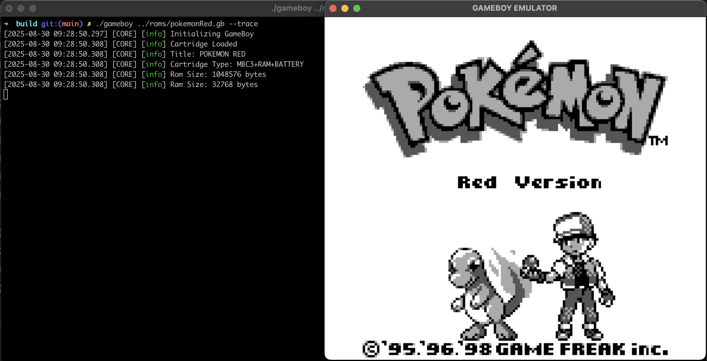

# GameBoy

[](https://github.com/RaviTriv/GameBoy/actions/workflows/ci.yml)


<p align="center">
  
  
  
</p>

DMG-01 Game Boy Emulator

## Building and Running

### Requirements

- **GCC 16**
- CMake 3.30+
- [spdlog](https://github.com/gabime/spdlog) 1.11+ and [fmt](https://github.com/fmtlib/fmt)
- [SDL3](https://github.com/libsdl-org/SDL) 3.2+ and [SDL3_ttf](https://github.com/libsdl-org/SDL_ttf) 3.2+ (app only)

### Build

```console
cmake -S . -B build -DCMAKE_BUILD_TYPE=Release
cmake --build build -j
```
### Run

```console
./build/gameboy <rom_path> [--loadSave] [--fastForward] [--trace]
```

| Argument | Required | Description |
|----------|----------|-------------|
| `<rom_path>` | Yes | Path to the Game Boy ROM file |
| `--loadSave` | No | Resume from the save state for this ROM |
| `--fastForward` | No | Start with fast forward enabled |
| `--trace` | No | Log a CPU instruction trace |


## Controls

| Keyboard Key | GameBoy Button | Function |
|--------------|----------------|----------|
| Z            | B              | B button |
| X            | A              | A button |
| Enter/Return | Start          | Start button |
| Tab          | Select         | Select button |
| ↑ (Up)       | D-pad Up       | Move up |
| ↓ (Down)     | D-pad Down     | Move down |
| ← (Left)     | D-pad Left     | Move left |
| → (Right)    | D-pad Right    | Move right |
| S            | N/A            | Save state |
| F            | N/A            | Toggle fast forward |

## Testing

Tested against various DMG rom test suites

| Suite | Tests | Passing |
|-------|------:|--------:|
| [GBMicrotest](https://github.com/aappleby/GBMicrotest) | 480 | 480 |
| [Mooneye Test Suite](https://github.com/Gekkio/mooneye-test-suite) | 95 | 95 |
| [Mooneye (Wilbert Pol)](https://github.com/wilbertpol/mooneye-gb) | 94 | 94 |
| [Blargg](https://github.com/retrio/gb-test-roms) | 42 | 42 |
| [Mealybug Tearoom](https://github.com/mattcurrie/mealybug-tearoom-tests) | 24 | 24 |
| [AGE](https://github.com/c-sp/age-test-roms) | 14 | 14 |
| [Scribbltests](https://github.com/Hacktix/scribbltests) | 5 | 5 |
| [MBC3 Tester](https://github.com/EricKirschenmann/MBC3-Tester-gb) and [rtc3test](https://github.com/aaaaaa123456789/rtc3test) | 4 | 4 |
| [TurtleTests](https://github.com/Powerlated/TurtleTests) | 2 | 2 |
| Save state round trips | 2 | 2 |
| [dmg-acid2](https://github.com/mattcurrie/dmg-acid2) | 1 | 1 |
| [Strikethrough](https://github.com/Hacktix/strikethrough.gb) | 1 | 1 |
| [little-things-gb](https://github.com/pinobatch/little-things-gb) | 1 | 1 |

### Running the tests

```console
cmake -S . -B build-test -DBUILD_APP=OFF -DBUILD_TESTS=ON -DCMAKE_BUILD_TYPE=Release
cmake --build build-test -j
ctest --test-dir build-test -j8
```

```console
ctest --test-dir build-test -L '^mooneye$'      # test suite
ctest --test-dir build-test -L ppu              # component
ctest --test-dir build-test -R mooneye.timer    # by test name
```